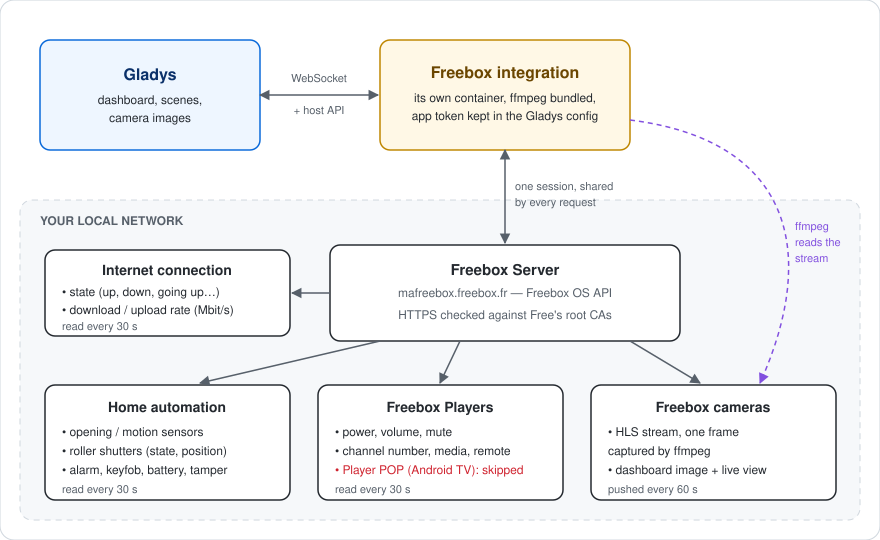
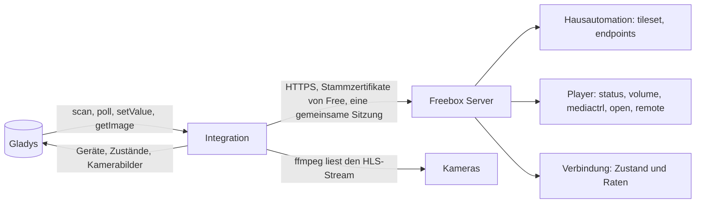
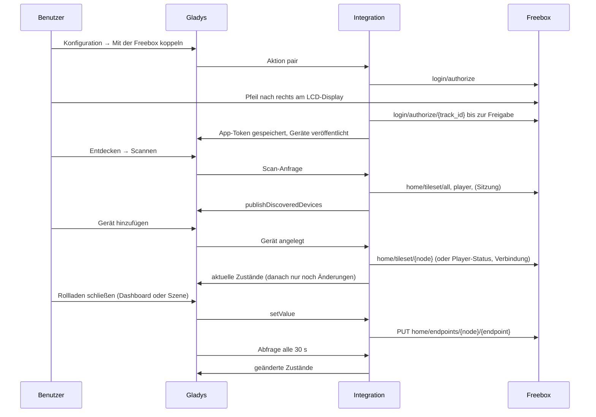
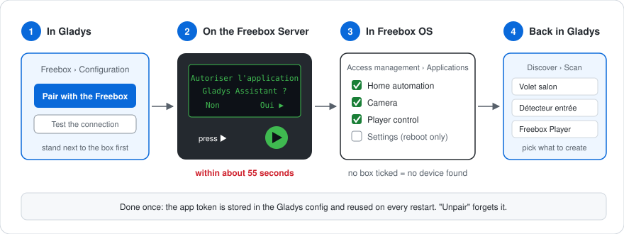
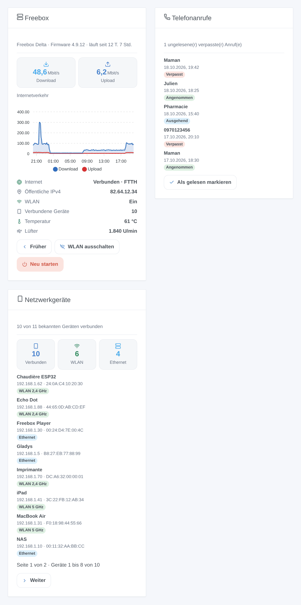
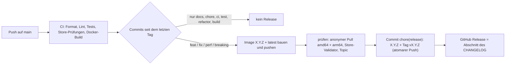

# Gladys Freebox

[English](README.md) · [Français](README.fr.md) · **Deutsch** · [Español](README.es.md)

[](LICENSE)
[](https://github.com/William-De71/gladys-freebox/releases)
[](https://github.com/William-De71/gladys-freebox/actions/workflows/release.yml)
[](https://gladysassistant.com)


Externe [Gladys Assistant](https://gladysassistant.com)-Integration, die Ihre **Freebox** in Gladys bringt:
Hausautomations-Sensoren, Rollläden und Alarmanlage, Freebox Player (Ein/Aus, Lautstärke, Sender, Wiedergabe,
Fernbedienungstasten), Kameras, den Zustand der Internetverbindung mit Download- und Upload-Rate, das WLAN und die
Temperaturen der Box, drei Dashboard-Widgets (die Box, das Anrufprotokoll, die Netzwerkgeräte) sowie Szenen-Auslöser.
Basiert auf `@gladysassistant/integration-sdk` 0.15.

Alles bleibt **in Ihrem lokalen Netzwerk**: Die Integration spricht mit der Freebox-OS-API unter
`mafreebox.freebox.fr`, ohne Free-Konto und ohne Cloud.

Benutzerdokumentation: [English](docs/en.md) · [Français](docs/fr.md) · [Deutsch](docs/de.md) ·
[Español](docs/es.md).

> Community-Integration, nicht mit Free verbunden und nicht von Free unterstützt.

## Inhalt

- [Funktionen](#funktionen)
- [Architektur](#architektur)
- [Geräte](#geräte)
- [Installation](#installation)
- [Konfiguration](#konfiguration)
- [Kopplung](#kopplung)
- [Freebox Player](#freebox-player)
- [Widgets](#widgets)
- [Szenen](#szenen)
- [Transport](#transport)
- [Entwicklung](#entwicklung)
- [Release und Commit-Konvention](#release-und-commit-konvention)
- [Fehlerbehebung](#fehlerbehebung)
- [Designentscheidungen](#designentscheidungen)
- [Mitwirken](#mitwirken)
- [Lizenz](#lizenz)

## Funktionen

- **Hausautomation**: Öffnungs- und Bewegungssensoren, Sabotagekontakte, Batteriestände, Rollläden (öffnen / stopp /
  schließen und Position), Alarmzentrale (scharf schalten, unscharf schalten, Verzögerung überspringen, Zustand) und
  Alarm-Fernbedienung.
- **Freebox Player** mit lokaler API: Ein/Aus, Lautstärke, Stummschaltung, Sender per Nummer, Wiedergabesteuerung und
  Fernbedienungstasten.
- **Kameras**: Dashboard-Bild jede Minute aktualisiert, frische Aufnahme für die Live-Ansicht (ffmpeg liest den
  HLS-Stream).
- **Internetverbindung**: ein Gerät **Freebox Server** mit dem Zustand der Verbindung (`up`, `down`, `going_up`,
  `going_down`) und der Download- und Upload-Rate in Mbit/s, um die Leitung zu überwachen und Szenen auszulösen, wenn
  sie ausfällt.
- **WLAN und Temperaturen**: Das Gerät **Freebox Server** trägt außerdem einen WLAN-Schalter (`switch` / `binary`,
  alle Zugangspunkte der Box) und einen `device-temperature-sensor` pro Sensor, den die Box meldet.
- **Dashboard-Widgets**: **Freebox** (Datenraten, von der Box gespeicherter Verkehrsverlauf, Temperatur,
  Internetverbindung, WLAN, verbundene Geräte, Lüfter, Schaltflächen zum Schalten des WLANs und zum Neustart),
  **Telefonanrufe** (Anrufprotokoll, als gelesen markieren) und **Netzwerkgeräte** (verbunden oder weg, mit IP- und
  MAC-Adresse).
- **Szenen**: Auslöser bei einem **Telefonanruf** und bei einem **Gerät, das sich mit dem Netzwerk verbindet oder es
  verlässt**, sowie eine Aktion **Wake-on-LAN**.
- **Konfigurationsaktionen**: koppeln, Verbindung testen, Freebox neu starten, Kopplung aufheben.
- **Vier Sprachen** für den Konfigurationsbildschirm und die Ergebnisse der Aktionen: Englisch, Französisch,
  Deutsch, Spanisch.

Jeder Zustand wird **bei einer Änderung** veröffentlicht, und ein gerade in Gladys hinzugefügtes Gerät erhält sofort
seine aktuellen Werte. Die Netzwerkgeräte und das Anrufprotokoll liest die Integration selbst alle 30 Sekunden (kein
Gerät nötig): Sie speisen die Widgets und die Szenen-Auslöser.

## Architektur





Vom Scan bis zum Befehl:



## Geräte

| Freebox-Seite                            | Gladys-Funktion (Kategorie / Typ)                                                 | Abfrage         |
| ---------------------------------------- | --------------------------------------------------------------------------------- | --------------- |
| Öffnungssensor                           | `opening-sensor` / `binary` (1 = geschlossen)                                     | alle 30 s       |
| Bewegungssensor                          | `motion-sensor` / `binary` (1 = Bewegung)                                         | alle 30 s       |
| Batterie, Sabotagekontakt                | `battery` / `integer` (%), `tamper` / `binary`                                    | alle 30 s       |
| Rollläden (`store`, `store_slider`)      | `shutter` / `state` (öffnen / stopp / schließen), `shutter` / `position` (%)      | alle 30 s       |
| Alarmzentrale                            | `button` / `push` (scharf, zweiter Bereich, unscharf, überspringen), `text`       | alle 30 s       |
| Alarm-Fernbedienung                      | `button` / `click` (ohne Gewähr: ein Druck zwischen zwei Abfragen geht verloren)  | alle 30 s       |
| Player mit lokaler API                   | `television` / Ein/Aus, Lautstärke, Stumm, Sender, Wiedergabe und Tasten          | alle 30 s       |
| Player ohne sie (Player POP, Android TV) | übersprungen, mit einer eindeutigen Logzeile                                      | —               |
| Kameras                                  | `camera` / `image` (Bild jede Minute, Live-Ansicht auf Abruf)                     | eigene Schleife |
| Freebox Server                           | `text` / `text` Verbindungszustand, `datarate` / `rate` Download, Upload          | alle 30 s       |
| Freebox Server (seit 1.4.0)              | `switch` / `binary` WLAN, `device-temperature-sensor` / `decimal` (°C) pro Sensor | alle 30 s       |

Die externen IDs behalten das native Schema der Freebox (`freebox:{node}:{endpoint}`, `freebox:player:{id}:{type}`,
`freebox:server:{feature}`), mit dem von Gladys verlangten Präfix `ext:<selector>:`. Die Selektoren werden aus
denselben IDs abgeleitet, sodass zwei gleichnamige Geräte nie kollidieren.

## Installation

1. Öffnen Sie in Gladys (`>= 5.1.0`) **Integrationen**, suchen Sie **Freebox** im Katalog und installieren Sie sie.
   Gladys lädt das Multi-Arch-Image (`linux/amd64`, `linux/arm64`) von `ghcr.io/william-de71/gladys-freebox`.
2. Gladys muss **hinter der Freebox** laufen (gleiches lokales Netzwerk), damit `mafreebox.freebox.fr` auf die Box
   zeigt.
3. Koppeln Sie die Integration (siehe [Kopplung](#kopplung)), erteilen Sie die Berechtigungen in Freebox OS, dann
   **Entdecken → Scannen** und fügen Sie die gewünschten Geräte hinzu.

## Konfiguration

| Feld / Aktion           | Zweck                                                                                             |
| ----------------------- | ------------------------------------------------------------------------------------------------- |
| Mit der Freebox koppeln | fordert ein App-Token bei der Box an; Bestätigung am LCD-Display innerhalb von etwa 55 Sekunden   |
| Verbindung testen       | öffnet eine Sitzung und zählt die Geräte, die die Box bereitstellt                                |
| Freebox neu starten     | startet den Freebox Server neu (Berechtigung zum Ändern der Freebox-Einstellungen nötig)          |
| Kopplung aufheben       | vergisst das App-Token; entziehen Sie die App auch in Freebox OS, um sie von der Box zu entfernen |

Zu aktivierende Berechtigungen in **Freebox OS → Settings → Access management → Applications → Gladys Assistant**:
Hausautomation und Alarm, Kameras, Steuerung des Freebox Players, das Ändern der Einstellungen für den Neustart und
den WLAN-Schalter sowie der Zugriff auf das Anrufprotokoll für das Widget und den Auslöser **Telefonanrufe**.
Internetverbindung, WLAN-Zustand, Temperaturen und Netzwerkgeräte brauchen keine Berechtigung: Das Lesen der
Einstellungen steht jeder gekoppelten App offen.

## Kopplung



Das App-Token wird über die Aktion **Mit der Freebox koppeln** bezogen und mit `gladys.setConfig()` unter einem
Schlüssel gespeichert, der **nicht** im `config_schema` deklariert ist, und bei jeder Verbindung neu geladen. Die
Kopplung wird gespeichert, sobald die Box sie gewährt: Schlägt das Auflisten der Geräte direkt danach fehl
(Berechtigungen noch nicht aktiviert), sagt die Aktion das, statt eine fehlgeschlagene Kopplung zu melden.

## Freebox Player


Die API der Freebox Player hat eine eigene Versionsnummer (`/player/{id}/api/v{n}`), und nur ein Teil dessen, was
eine Fernbedienung kann, ist dokumentiert. Befehle über die virtuelle Fernbedienung (`control/remote`) bleiben
erhalten, weil kein dokumentierter Endpunkt die Navigationstasten erreicht, werden in der Benutzerdokumentation aber
als ohne Gewähr gekennzeichnet. „Play“ und „Pause“ teilen sich den einzigen Befehl `play_pause`, und „Stumm“
schaltet den unmittelbar zuvor gelesenen tatsächlichen Zustand um.

## Widgets



| Widget (Schlüssel)         | Inhalt                                                                                                                        | Einstellung                       | Schaltflächen                                   |
| -------------------------- | ----------------------------------------------------------------------------------------------------------------------------- | --------------------------------- | ----------------------------------------------- |
| Freebox (`box`)            | Datenraten, höchste Temperatur, Verkehrsdiagramm (RRD), Internetverbindung, öffentliche IPv4, WLAN, verbundene Geräte, Lüfter | `period`: Stunde, Tag, Woche      | WLAN aus / ein, Neu starten (mit Bestätigung)   |
| Telefonanrufe (`calls`)    | die letzten 8 Anrufe mit Typ und Datum; Nummer und Dauer im Detailfenster                                                     | `show`: alle, verpasste           | Als gelesen markieren (bei ungelesenen Anrufen) |
| Netzwerkgeräte (`network`) | Anzahl verbundener Geräte (WLAN, Ethernet), bis zu 8 Geräte mit IP- und MAC-Adresse; Hersteller im Detailfenster              | `show`: verbunden, getrennt, alle | —                                               |

Die Bilder werden aus dem echten Widget-Code erzeugt (`docs/illustrations/render.sh`), es sind keine Screenshots. Die
Karte **Freebox** liest die Box beim Anzeigen (30 Sekunden Cache); die beiden anderen lesen den Stand der
Überwachungsschleife und kosten daher keine Anfrage an die Box. Das Anrufprotokoll braucht die Berechtigung **Zugriff
auf das Anrufprotokoll**: Ohne sie erklärt die Karte, wie man sie erteilt.

## Szenen

Die Integration deklariert zwei Szenen-Auslöser und eine Szenen-Aktion (Kategorie **Integrationen** des Szenen-Editors):

| Schlüssel                 | Art                                                               | Filter                                               | Variablen / Ausgaben                                 |
| ------------------------- | ----------------------------------------------------------------- | ---------------------------------------------------- | ---------------------------------------------------- |
| `phone_call`              | Auslöser: ein Anruf ist ins Protokoll gekommen (nach seinem Ende) | `call_type` (Mehrfachauswahl), `number`              | `call_type`, `number`, `name`, `duration`            |
| `network_device_presence` | Auslöser: ein Gerät hat sich verbunden oder ist weg               | `event` (`connected`, `disconnected`), `mac`, `name` | `event`, `mac`, `name`, `ip`, `connection`, `vendor` |
| `wake_on_lan`             | Aktion: die Box sendet ein Wake-on-LAN-Paket                      | `mac` (Pflicht)                                      | keine                                                |

Die erste Lesung nach einem Start dient als Ausgangsstand: Kein Anruf und keine Anwesenheitsänderung wird nachgeholt.
Alle anderen Werte sind Gerätefunktionen und im Szenen-Editor von Gladys wie jede andere nutzbar.

| Wenn…                                    | Auslöser in Gladys                                               |
| ---------------------------------------- | ---------------------------------------------------------------- |
| eine Tür aufgeht, während niemand da ist | Öffnungssensor → Wert 0, mit der Bedingung „Haus leer“           |
| nachts eine Bewegung erkannt wird        | Bewegungssensor → Wert 1, mit einer Zeitbedingung                |
| die Internetverbindung ausfällt          | Freebox Server → Internet connection → Text gleich `down`        |
| die Verbindung wieder da ist             | Freebox Server → Internet connection → Text gleich `up`          |
| die Download-Rate hoch bleibt            | Freebox Server → Download rate → über einem Schwellwert (Mbit/s) |

Aktionen funktionieren genauso: Rollläden schließen, den Alarm scharf schalten (`button` / `push`), einen Player
einschalten, einen Sender per Nummer einstellen. Der Zustand der Alarmzentrale ist der Text der Freebox (`idle`, wenn
sie unscharf ist): Lesen Sie ihn im Dashboard ab, um eine Bedingung darauf zu schreiben.

## Transport

Nur `local`. Die Integration erreicht die Freebox-OS-API unter `mafreebox.freebox.fr` per HTTPS, geprüft gegen die
Stammzertifikate von Free, und liest die Kamera-Streams im lokalen Netzwerk; sie ruft nie einen Server von Free auf.

## Entwicklung

```bash
npm install
npm test               # Unit-Tests (node --test), ohne Netzwerk und ohne Freebox
npm run lint           # ESLint
npm run format:check   # Prettier, wie in der CI
npx github:GladysAssistant/integration-store . --skip-image-check   # Store-Prüfungen
docker build -t gladys-freebox:dev .
```

`ffmpeg` muss im `PATH` liegen, um Kamerabilder aufzunehmen; das Docker-Image installiert es. Aufbau des Codes:
siehe [CLAUDE.md](CLAUDE.md). `scripts/diagnose-realtime.js` untersucht eine echte Box (Websocket, schnelle Abfrage)
und ist nicht Teil des Images.

- `test/structure.test.js` vergleicht die aus Beispielknoten gebauten Geräte (Sensoren, Rollläden, Alarm,
  Fernbedienung, Kamera, Player) und die Konfigurations- und Aktionsschlüssel mit
  `test/fixtures/discovery.baseline.json`, erzeugt aus Version 1.2.0: Eine externe ID, ein Selektor, eine Kategorie,
  ein Typ oder eine Grenze ändert sich nie — sonst müssten Benutzer ihre Geräte löschen und neu anlegen.
- `test/index.test.js` führt `index.js` gegen das falsche Gladys des SDK aus (Entdeckung, Anlegen, Abfragen).
- `test/i18n.test.js` prüft die vier Sprachen des Manifests, der Dokumentation und der READMEs;
  `test/messages.test.js` die der Aktionsergebnisse.
- `test/release.test.js` deckt das Release-Skript ab (Versionen, Changelog, Versionsanhebung).

Voraussetzungen: Gladys `>= 5.1.0` (Widgets, Szenen-Auslöser und -Aktionen), Node.js `>= 22.20`.

## Release und Commit-Konvention

Releases laufen automatisch. Jeder Push auf `main` startet den Release-Workflow:



- Commits und PR-Titel folgen [Conventional Commits](https://www.conventionalcommits.org/de/), auf Englisch, für
  den Benutzer geschrieben: Sie werden zu den Zeilen des Changelogs. `feat` → Minor, `fix` / `perf` → Patch, `!`
  oder `BREAKING CHANGE:` → Major.
- `CHANGELOG.md` wird beim Release erzeugt: nie von Hand bearbeiten.
- Das Image wird veröffentlicht und geprüft, **bevor** das Manifest auf `main` die neue Version ankündigt.
- Manueller Start (Actions → Release → Run workflow): `release-as` erzwingt eine Version, `dry-run` zeigt nur die
  Version und die Notizen.
- Ein geschützter `main`-Branch würde den Release-Commit ablehnen: Erlauben Sie GitHub Actions, die Regel zu umgehen,
  oder verwenden Sie das Token einer GitHub App.

## Fehlerbehebung

| Symptom                                                    | Wahrscheinliche Ursache                                                                 |
| ---------------------------------------------------------- | --------------------------------------------------------------------------------------- |
| „Freebox not found on the local network“                   | Gladys steht nicht hinter der Freebox, oder `mafreebox.freebox.fr` wird nicht aufgelöst |
| Kopplung „not confirmed on the LCD screen“                 | die 55 Sekunden sind abgelaufen: neben die Box stellen und die Aktion erneut starten    |
| Ein Gerät fehlt beim Scan                                  | seine Berechtigung ist in Freebox OS nicht aktiviert: aktivieren, dann erneut scannen   |
| „Freebox session could not be opened“                      | die App wurde in Freebox OS entzogen: Kopplung aufheben, dann neu koppeln               |
| Ein Player fehlt                                           | Player POP / Android TV: keine lokale API, die Integration überspringt ihn              |
| Eine Fernbedienungstaste bewirkt nichts                    | undokumentierte `control/remote`-Taste, nicht von jeder Player-Firmware unterstützt     |
| Kein Kamerabild                                            | den Stream in Freebox OS prüfen; das Bild wird jede Minute aktualisiert                 |
| Kein Gerät „Freebox Server“ bei einer älteren Installation | neues Gerät: Entdecken → Scannen, dann hinzufügen                                       |

Ausführliche Logs: Setzen Sie die Umgebungsvariable `DEBUG=gladys-integration-sdk` am Container.

## Designentscheidungen

**Das Zertifikat der Freebox wird geprüft.** Die Box liefert ein Zertifikat der eigenen Zertifizierungsstellen von
Free: die RSA-„Freebox Root CA“ bei älteren Boxen, die „Freebox ECC Root CA“ (über eine Zwischenstelle) bei aktuellen.
Beide sind eingebettet und die Kette wird geprüft; die Namensprüfung akzeptiert auch den eigenen Namen der Box,
`*.fbxos.fr`.

**Eine Sitzung für alle Anfragen.** Gladys fragt alle Geräte im selben Takt ab. Die Anmeldung (Challenge +
HMAC-SHA1) wird zwischen gleichzeitigen Aufrufen geteilt, und eine Anfrage, deren Sitzung abgelaufen ist, nutzt die
Sitzung, die eine andere Anfrage gerade neu geöffnet hat.

**Nur Änderungen.** Jeder Knoten wird zweimal pro Minute gelesen, aber ein Wert wird nur veröffentlicht, wenn er sich
geändert hat: Gladys nimmt 300 Zustände pro Minute von einer Integration an, und ein Haus mit zwanzig Sensoren, das
alles erneut sendete, erreichte die Hälfte davon. Fügt der Benutzer ein Gerät hinzu, wird es sofort gelesen, denn
Gladys verwirft die Zustände, die gesendet werden, bevor ein Gerät existiert.

**Ein Wert, den die Box nicht hat, wird nicht veröffentlicht.** Die Freebox antwortet `null` auf Endpunkten, die nie
aktualisiert wurden (eine Batterie vor ihrer ersten Meldung): Die Leser liefern nichts, und die Abfrage überspringt
sie, statt einen falschen Alarm „Batterie leer“ auszulösen.

**Kameras bleiben außerhalb der Abfrage.** Eine ffmpeg-Aufnahme dauert mehrere Sekunden, länger als die 5 Sekunden
Bestätigungsfrist einer Abfrage: Die Bilder werden von einer eigenen Schleife gesendet und für die Live-Ansicht auf
Abruf aufgenommen.

**Der Verbindungszustand ist das Wort der Freebox.** `up`, `down`, `going_up` und `going_down` werden als Text
veröffentlicht, genau wie die API sie nennt: Eine Szene vergleicht mit einem Wert, der sich nicht mit der Sprache des
Benutzers ändert.

## Mitwirken

Issues und Pull Requests sind willkommen: Fehlerberichte mit der Gladys-Version, der Version der Integration, dem
Freebox-Modell und den Logs ([Issue-Vorlagen](.github/ISSUE_TEMPLATE)). Rückmeldungen auch im
[Gladys-Forum](https://community.gladysassistant.com/t/probleme-installation-integration-freebox/10399) (auf
Französisch). Sicherheitsprobleme: siehe [SECURITY.md](SECURITY.md).

## Lizenz

[Apache-2.0](LICENSE) — siehe [NOTICE](NOTICE). Freebox ist eine Marke von Free; dieses Projekt ist nicht mit Free
verbunden.
