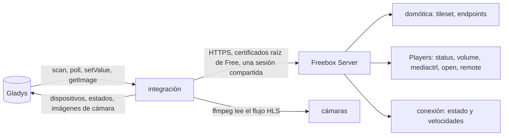
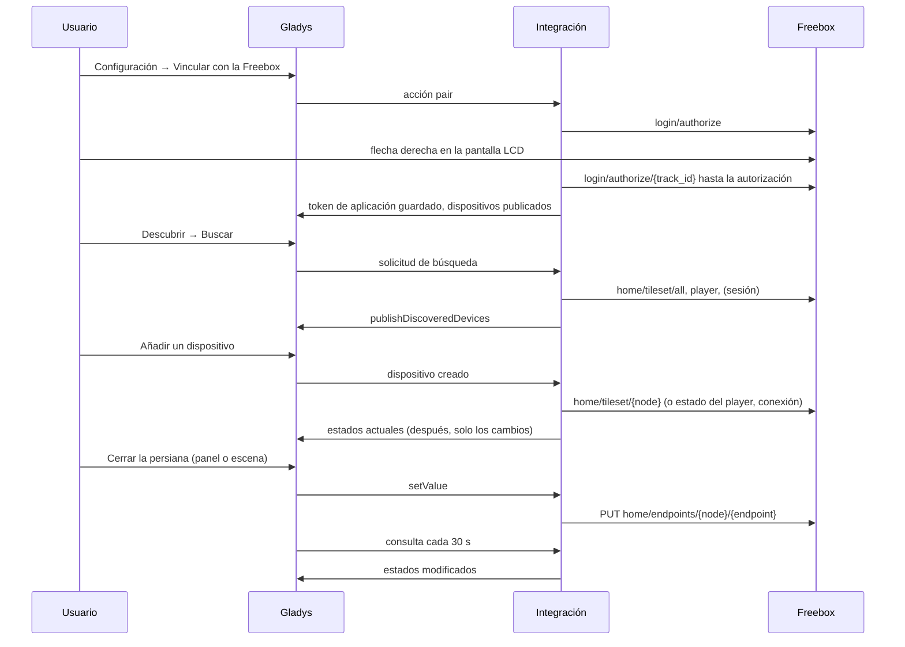
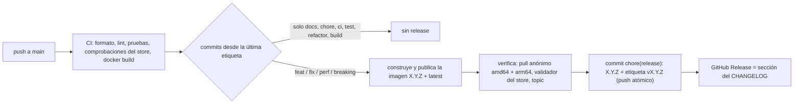

# Gladys Freebox

[English](README.md) · [Français](README.fr.md) · [Deutsch](README.de.md) · **Español**

[](LICENSE)
[](https://github.com/William-De71/gladys-freebox/releases)
[](https://github.com/William-De71/gladys-freebox/actions/workflows/release.yml)
[](https://gladysassistant.com)


Integración externa de [Gladys Assistant](https://gladysassistant.com) que lleva su **Freebox** a Gladys: sensores
domóticos, persianas y alarma, Freebox Players (encendido, volumen, canales, reproducción, teclas del mando),
cámaras, y el estado de la conexión a internet con sus velocidades de bajada y de subida. Basada en
`@gladysassistant/integration-sdk` 0.15.

Todo se queda **en su red local**: la integración habla con la API de Freebox OS en `mafreebox.freebox.fr`, sin
cuenta de Free y sin nube.

Documentación de usuario: [English](docs/en.md) · [Français](docs/fr.md) · [Deutsch](docs/de.md) ·
[Español](docs/es.md).

> Integración comunitaria, sin relación con Free ni respaldada por Free.

## Índice

- [Funciones](#funciones)
- [Arquitectura](#arquitectura)
- [Dispositivos](#dispositivos)
- [Instalación](#instalación)
- [Configuración](#configuración)
- [Vinculación](#vinculación)
- [Freebox Players](#freebox-players)
- [Escenas](#escenas)
- [Transporte](#transporte)
- [Desarrollo](#desarrollo)
- [Release y convención de commits](#release-y-convención-de-commits)
- [Solución de problemas](#solución-de-problemas)
- [Decisiones de diseño](#decisiones-de-diseño)
- [Contribuir](#contribuir)
- [Licencia](#licencia)

## Funciones

- **Domótica**: sensores de apertura y de movimiento, contactos antisabotaje, niveles de batería, persianas (abrir /
  parar / cerrar y posición), central de alarma (armar, desarmar, saltar el retardo, estado) y mando de la alarma.
- **Freebox Players** que exponen la API local: encendido, volumen, silencio, canal por su número, control de la
  reproducción y teclas del mando.
- **Cámaras**: imagen del panel actualizada cada minuto, captura reciente para la vista en directo (ffmpeg lee el
  flujo HLS).
- **Conexión a internet**: un dispositivo **Freebox Server** con el estado de la conexión (`up`, `down`, `going_up`,
  `going_down`) y las velocidades de bajada y de subida en Mbit/s, para vigilar la línea y lanzar escenas cuando se
  cae.
- **Acciones de configuración**: vincular, probar la conexión, reiniciar la Freebox, desvincular.
- **Cuatro idiomas** para la pantalla de configuración y los resultados de las acciones: inglés, francés, alemán,
  español.

Cada estado se publica **cuando cambia**, y un dispositivo recién añadido en Gladys recibe de inmediato sus valores
actuales. La integración no declara ningún widget de panel propio: los dispositivos usan las cajas de Gladys.

## Arquitectura




De la búsqueda al comando:



## Dispositivos

| Lado Freebox                              | Función de Gladys (categoría / tipo)                                           | Consulta     |
| ----------------------------------------- | ------------------------------------------------------------------------------ | ------------ |
| Sensor de apertura                        | `opening-sensor` / `binary` (1 = cerrado)                                      | cada 30 s    |
| Sensor de movimiento                      | `motion-sensor` / `binary` (1 = movimiento)                                    | cada 30 s    |
| Batería, contacto antisabotaje            | `battery` / `integer` (%), `tamper` / `binary`                                 | cada 30 s    |
| Persianas (`store`, `store_slider`)       | `shutter` / `state` (abrir / parar / cerrar), `shutter` / `position` (%)       | cada 30 s    |
| Central de alarma                         | `button` / `push` (armar, armar zona secundaria, desarmar, saltar), `text`     | cada 30 s    |
| Mando de la alarma                        | `button` / `click` (sin garantía: una pulsación entre dos consultas se pierde) | cada 30 s    |
| Players con API local                     | `television` / encendido, volumen, silencio, canal, reproducción y teclas      | cada 30 s    |
| Players sin ella (Player POP, Android TV) | omitidos, con una línea de log explícita                                       | —            |
| Cámaras                                   | `camera` / `image` (imagen cada minuto, vista en directo bajo demanda)         | bucle propio |
| Freebox Server                            | `text` / `text` estado de la conexión, `datarate` / `rate` bajada, subida      | cada 30 s    |

Los identificadores externos conservan el esquema nativo de la Freebox (`freebox:{node}:{endpoint}`,
`freebox:player:{id}:{type}`, `freebox:server:{feature}`), con el prefijo `ext:<selector>:` que exige Gladys. Los
selectores se derivan de los mismos identificadores, así que dos homónimos nunca chocan.

## Instalación

1. En Gladys (`>= 4.86.0`), abra **Integraciones**, busque **Freebox** en el catálogo e instálela. Gladys descarga la
   imagen multiarquitectura (`linux/amd64`, `linux/arm64`) desde `ghcr.io/william-de71/gladys-freebox`.
2. Gladys debe ejecutarse **detrás de la Freebox** (misma red local), para que `mafreebox.freebox.fr` apunte a la
   caja.
3. Vincule la integración (vea [Vinculación](#vinculación)), conceda los permisos en Freebox OS, luego
   **Descubrir → Buscar** y añada los dispositivos que quiera.

## Configuración

| Campo / acción          | Función                                                                                       |
| ----------------------- | --------------------------------------------------------------------------------------------- |
| Vincular con la Freebox | pide un token de aplicación a la caja; confirme en la pantalla LCD en unos 55 segundos        |
| Probar la conexión      | abre una sesión y cuenta los dispositivos que expone la caja                                  |
| Reiniciar la Freebox    | reinicia el Freebox Server (necesita el permiso de modificación de los ajustes de la Freebox) |
| Desvincular la Freebox  | olvida el token; revoque también la aplicación en Freebox OS para quitarla de la caja         |

Permisos que activar en **Freebox OS → Settings → Access management → Applications → Gladys Assistant**: domótica y
alarma, cámaras, control del Freebox Player y, para el reinicio, la modificación de los ajustes. La conexión a
internet no necesita ningún permiso: leer los ajustes está abierto a toda aplicación vinculada.

## Vinculación


El token de aplicación se obtiene con la acción **Vincular con la Freebox** y se guarda con `gladys.setConfig()` bajo
una clave **no** declarada en el `config_schema`, y se vuelve a leer en cada conexión. La vinculación se guarda en
cuanto la caja la concede: si la lista de dispositivos falla justo después (permisos aún sin activar), la acción lo
indica en lugar de anunciar una vinculación fallida.

## Freebox Players


La API de los Freebox Players tiene su propio número de versión (`/player/{id}/api/v{n}`), y solo una parte de lo que
hace un mando está documentada. Los comandos que pasan por el mando virtual (`control/remote`) se mantienen porque
ningún punto de acceso documentado alcanza las teclas de navegación, pero la documentación de usuario los señala como
sin garantía. «Reproducir» y «Pausa» comparten el único comando `play_pause`, y «Silencio» invierte el estado real
leído justo antes.

## Escenas

La integración no declara desencadenantes ni acciones de escena propios: cada valor es una función de dispositivo,
utilizable en el editor de escenas de Gladys como cualquier otra.

| Cuando…                                   | Desencadenante en Gladys                                          |
| ----------------------------------------- | ----------------------------------------------------------------- |
| se abre una puerta y no hay nadie en casa | Sensor de apertura → valor 0, con la condición «casa vacía»       |
| se detecta movimiento de noche            | Sensor de movimiento → valor 1, con una condición horaria         |
| se cae la conexión a internet             | Freebox Server → Internet connection → texto igual a `down`       |
| vuelve la conexión                        | Freebox Server → Internet connection → texto igual a `up`         |
| la velocidad de bajada sigue alta         | Freebox Server → Download rate → por encima de un umbral (Mbit/s) |

Las acciones funcionan igual: cerrar las persianas, armar la alarma (`button` / `push`), encender un Player, poner un
canal por su número. El estado de la central de alarma es el texto de la Freebox (`idle` cuando está desarmada):
consúltelo en el panel para escribir una condición sobre él.

## Transporte

Solo `local`. La integración llega a la API de Freebox OS en `mafreebox.freebox.fr` por HTTPS, verificado con los
certificados raíz de Free, y lee los flujos de las cámaras en la red local; nunca llama a un servidor de Free.

## Desarrollo

```bash
npm install
npm test               # pruebas unitarias (node --test), sin red ni Freebox
npm run lint           # ESLint
npm run format:check   # Prettier, como en la CI
npx github:GladysAssistant/integration-store . --skip-image-check   # comprobaciones del store
docker build -t gladys-freebox:dev .
```

`ffmpeg` debe estar en el `PATH` para capturar las imágenes de las cámaras; la imagen Docker lo instala. Organización
del código: vea [CLAUDE.md](CLAUDE.md). `scripts/diagnose-realtime.js` sondea una caja real (websocket, consulta
rápida) y no forma parte de la imagen.

- `test/structure.test.js` compara los dispositivos construidos a partir de nodos de ejemplo (sensores, persianas,
  alarma, mando, cámara, Player) y las claves de configuración y de acciones con
  `test/fixtures/discovery.baseline.json`, generado desde la versión 1.2.0: un identificador externo, un selector,
  una categoría, un tipo o un límite nunca cambia — los usuarios tendrían que borrar y volver a crear sus
  dispositivos.
- `test/index.test.js` ejecuta `index.js` contra el Gladys falso del SDK (descubrimiento, creación, consultas).
- `test/i18n.test.js` comprueba los cuatro idiomas del manifiesto, de la documentación y de los README;
  `test/messages.test.js` los de los resultados de las acciones.
- `test/release.test.js` cubre el script de release (versiones, changelog, actualización de versiones).

Requisitos: Gladys `>= 4.86.0` (categorías del store), Node.js `>= 22.20`.

## Release y convención de commits

Las releases son automáticas. Cada push a `main` lanza el workflow Release:



- Los commits y títulos de PR siguen [Conventional Commits](https://www.conventionalcommits.org/es/), en inglés,
  escritos para el usuario: se convierten en las líneas del changelog. `feat` → menor, `fix` / `perf` → parche, `!`
  o `BREAKING CHANGE:` → mayor.
- `CHANGELOG.md` se genera en la release: nunca lo edite a mano.
- La imagen se publica y se verifica **antes** de que el manifiesto de `main` anuncie la nueva versión.
- Ejecución manual (Actions → Release → Run workflow): `release-as` fuerza una versión, `dry-run` solo muestra la
  versión y las notas.
- Una rama `main` protegida rechazaría el commit de release: permita que GitHub Actions omita la regla, o use el token
  de una GitHub App.

## Solución de problemas

| Síntoma                                                 | Causa probable                                                                       |
| ------------------------------------------------------- | ------------------------------------------------------------------------------------ |
| «Freebox not found on the local network»                | Gladys no está detrás de la Freebox, o `mafreebox.freebox.fr` no se resuelve         |
| Vinculación «not confirmed on the LCD screen»           | pasaron los 55 segundos: colóquese junto a la caja y vuelva a lanzar la acción       |
| Falta un dispositivo en la búsqueda                     | su permiso no está activado en Freebox OS: actívelo y vuelva a buscar                |
| «Freebox session could not be opened»                   | la aplicación se revocó en Freebox OS: desvincule y vuelva a vincular                |
| Falta un Player                                         | Player POP / Android TV: sin API local, la integración lo omite                      |
| Una tecla del mando no hace nada                        | tecla `control/remote` no documentada, no admitida por todos los firmwares de Player |
| No hay imagen de cámara                                 | compruebe el flujo en Freebox OS; la imagen se actualiza cada minuto                 |
| No aparece «Freebox Server» en una instalación anterior | dispositivo nuevo: Descubrir → Buscar, y luego añádalo                               |

Logs detallados: defina la variable de entorno `DEBUG=gladys-integration-sdk` en el contenedor.

## Decisiones de diseño

**Se verifica el certificado de la Freebox.** La caja presenta un certificado emitido por las autoridades propias de
Free: la «Freebox Root CA» RSA en las cajas antiguas, la «Freebox ECC Root CA» (a través de una intermedia) en las
actuales. Ambas van incluidas y se comprueba la cadena; la comprobación del nombre acepta también el nombre propio de
la caja, `*.fbxos.fr`.

**Una sola sesión para todas las peticiones.** Gladys consulta todos los dispositivos a la vez. El inicio de sesión
(challenge + HMAC-SHA1) se comparte entre llamadas simultáneas, y una petición que encuentra su sesión caducada
reutiliza la que otra petición acaba de reabrir.

**Solo los cambios.** Cada nodo se lee dos veces por minuto, pero un valor solo se publica si ha cambiado: Gladys
acepta 300 estados por minuto de una integración, y una casa con veinte sensores que lo reenviaba todo llegaba a la
mitad. Cuando el usuario añade un dispositivo, se lee de inmediato, ya que Gladys descarta los estados enviados antes
de que exista un dispositivo.

**Un valor que la caja no tiene no se publica.** La Freebox responde `null` en los puntos de acceso nunca actualizados
(una batería antes de su primer informe): los lectores no devuelven nada y la consulta los omite en lugar de lanzar
una falsa alerta de «batería vacía».

**Las cámaras quedan fuera de la consulta.** Una captura ffmpeg tarda varios segundos, más que los 5 segundos de
confirmación de una consulta: las imágenes las envía un bucle propio y se capturan bajo demanda para la vista en
directo.

**El estado de la conexión es la palabra de la Freebox.** `up`, `down`, `going_up` y `going_down` se publican como
texto, tal como los nombra la API: una escena compara con un valor que no cambia con el idioma del usuario.

## Contribuir

Las issues y pull requests son bienvenidas: informes de error con la versión de Gladys, la versión de la integración,
el modelo de Freebox y los logs ([plantillas de issue](.github/ISSUE_TEMPLATE)). Comentarios también en el
[foro de Gladys](https://community.gladysassistant.com/t/probleme-installation-integration-freebox/10399) (en
francés). Problemas de seguridad: vea [SECURITY.md](SECURITY.md).

## Licencia

[Apache-2.0](LICENSE) — vea [NOTICE](NOTICE). Freebox es una marca de Free; este proyecto no está afiliado a Free.
