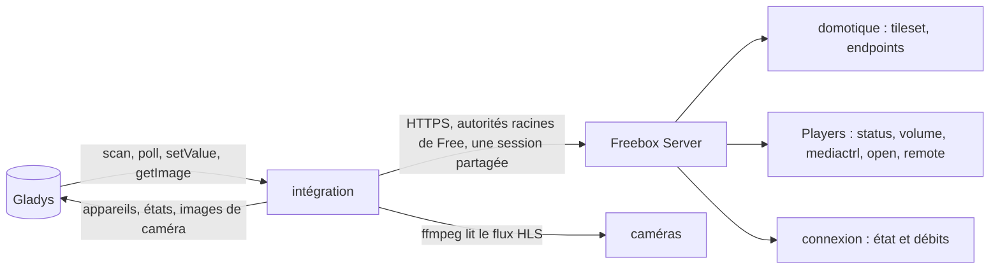
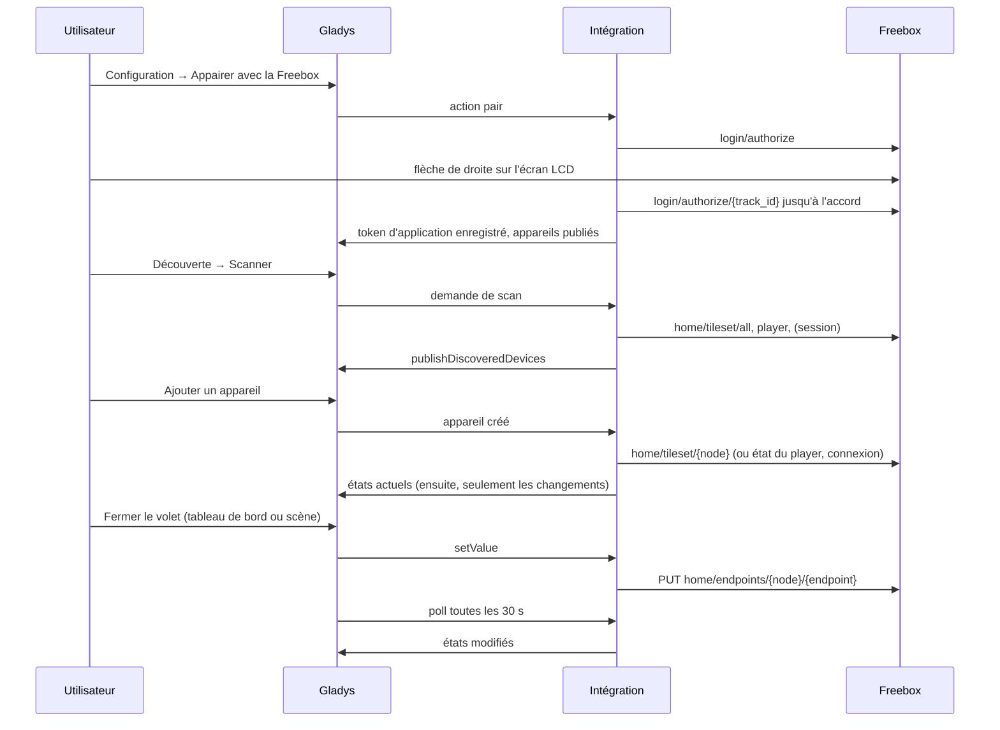
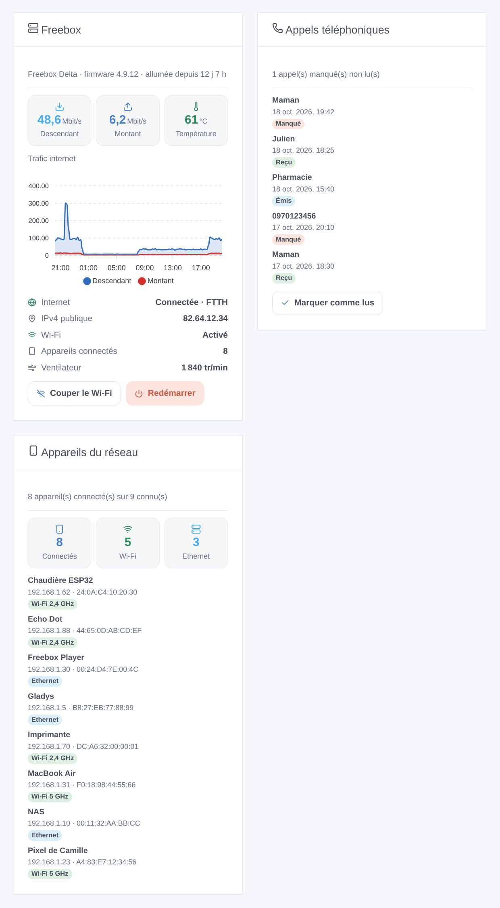
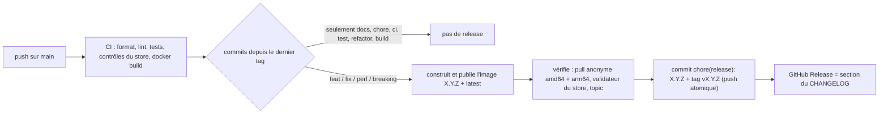

# Gladys Freebox

[English](README.md) · **Français** · [Deutsch](README.de.md) · [Español](README.es.md)

[](LICENSE)
[](https://github.com/William-De71/gladys-freebox/releases)
[](https://github.com/William-De71/gladys-freebox/actions/workflows/release.yml)
[](https://gladysassistant.com)


Intégration externe [Gladys Assistant](https://gladysassistant.com) qui amène votre **Freebox** dans Gladys : capteurs
domotiques, volets roulants et alarme, Freebox Players (allumage, volume, chaînes, lecture, touches de la
télécommande), caméras, l'état de la connexion internet avec ses débits descendant et montant, le Wi-Fi et les
températures de la box, trois widgets de tableau de bord (la box, le journal d'appels, les appareils du réseau) et des
déclencheurs de scène. Construite sur `@gladysassistant/integration-sdk` 0.15.

Tout reste **sur votre réseau local** : l'intégration dialogue avec l'API Freebox OS sur `mafreebox.freebox.fr`, sans
compte Free et sans cloud.

Documentation utilisateur : [English](docs/en.md) · [Français](docs/fr.md) · [Deutsch](docs/de.md) ·
[Español](docs/es.md).

> Intégration communautaire, sans lien avec Free ni approuvée par Free.

## Sommaire

- [Fonctionnalités](#fonctionnalités)
- [Architecture](#architecture)
- [Appareils](#appareils)
- [Installation](#installation)
- [Configuration](#configuration)
- [Appairage](#appairage)
- [Freebox Players](#freebox-players)
- [Widgets](#widgets)
- [Scènes](#scènes)
- [Transport](#transport)
- [Développement](#développement)
- [Release et convention de commits](#release-et-convention-de-commits)
- [Dépannage](#dépannage)
- [Choix de conception](#choix-de-conception)
- [Contribuer](#contribuer)
- [Licence](#licence)

## Fonctionnalités

- **Domotique** : capteurs d'ouverture et de mouvement, contacts anti-arrachement, niveaux de batterie, volets
  roulants (ouvrir / stop / fermer et position), centrale d'alarme (armer, désarmer, passer le délai, état) et
  télécommande d'alarme.
- **Freebox Players** exposant l'API locale : allumage, volume, coupure du son, chaîne par son numéro, contrôle de la
  lecture et touches de la télécommande.
- **Caméras** : image du tableau de bord rafraîchie chaque minute, capture fraîche pour la vue en direct (ffmpeg lit
  le flux HLS).
- **Connexion internet** : un appareil **Freebox Server** avec l'état de la connexion (`up`, `down`, `going_up`,
  `going_down`) et les débits descendant et montant en Mbit/s, pour surveiller la ligne et déclencher des scènes
  quand elle tombe.
- **Wi-Fi et températures** : l'appareil **Freebox Server** porte aussi un interrupteur Wi-Fi (`switch` / `binary`,
  tous les points d'accès de la box) et un `device-temperature-sensor` par capteur que la box liste.
- **Widgets de tableau de bord** : **Freebox** (débits, historique du trafic conservé par la box, température,
  connexion internet, Wi-Fi, appareils connectés, ventilateur, boutons pour couper le Wi-Fi et redémarrer), **Appels
  téléphoniques** (journal d'appels, marquer comme lus) et **Appareils du réseau** (connectés ou partis, avec adresses
  IP et MAC).
- **Scènes** : déclencheurs sur un **appel téléphonique** et sur un **appareil qui se connecte au réseau ou le
  quitte**, et une action **Wake-on-LAN**.
- **Actions de configuration** : appairer, tester la connexion, redémarrer la Freebox, désappairer.
- **Quatre langues** pour l'écran de configuration et les résultats des actions : anglais, français, allemand,
  espagnol.

Chaque état est publié **quand il change**, et un appareil tout juste ajouté dans Gladys reçoit aussitôt ses valeurs
actuelles. Les appareils du réseau et le journal d'appels sont lus toutes les 30 secondes par l'intégration elle-même
(aucun appareil requis) : ils alimentent les widgets et les déclencheurs de scène.

## Architecture




Du scan à la commande :



## Appareils

| Côté Freebox                               | Fonctionnalité Gladys (catégorie / type)                                            | Interrogation   |
| ------------------------------------------ | ----------------------------------------------------------------------------------- | --------------- |
| Capteur d'ouverture                        | `opening-sensor` / `binary` (1 = fermé)                                             | toutes les 30 s |
| Capteur de mouvement                       | `motion-sensor` / `binary` (1 = mouvement)                                          | toutes les 30 s |
| Batterie, contact anti-arrachement         | `battery` / `integer` (%), `tamper` / `binary`                                      | toutes les 30 s |
| Volets roulants (`store`, `store_slider`)  | `shutter` / `state` (ouvrir / stop / fermer), `shutter` / `position` (%)            | toutes les 30 s |
| Centrale d'alarme                          | `button` / `push` (armer, armer en secondaire, désarmer, passer), `text`            | toutes les 30 s |
| Télécommande d'alarme                      | `button` / `click` (au mieux : un appui entre deux lectures est manqué)             | toutes les 30 s |
| Players exposant l'API locale              | `television` / allumage, volume, muet, chaîne, lecture et touches                   | toutes les 30 s |
| Players sans elle (Player POP, Android TV) | ignorés, avec une ligne de log explicite                                            | —               |
| Caméras                                    | `camera` / `image` (image chaque minute, vue en direct à la demande)                | boucle dédiée   |
| Freebox Server                             | `text` / `text` état de la connexion, `datarate` / `rate` descendant, montant       | toutes les 30 s |
| Freebox Server (depuis 1.4.0)              | `switch` / `binary` Wi-Fi, `device-temperature-sensor` / `decimal` (°C) par capteur | toutes les 30 s |

Les identifiants externes gardent le schéma natif de la Freebox (`freebox:{node}:{endpoint}`,
`freebox:player:{id}:{type}`, `freebox:server:{feature}`), préfixés par `ext:<selector>:` comme Gladys l'exige. Les
sélecteurs sont dérivés des mêmes identifiants : deux homonymes n'entrent jamais en collision.

## Installation

1. Dans Gladys (`>= 5.3.0`), ouvrez **Intégrations**, trouvez **Freebox** dans le catalogue et installez-la. Gladys
   télécharge l'image multi-architecture (`linux/amd64`, `linux/arm64`) depuis `ghcr.io/william-de71/gladys-freebox`.
2. Gladys doit tourner **derrière la Freebox** (même réseau local), pour que `mafreebox.freebox.fr` désigne la box.
3. Appairez l'intégration (voir [Appairage](#appairage)), accordez les permissions dans Freebox OS, puis
   **Découverte → Scanner** et ajoutez les appareils voulus.

## Configuration

| Champ / action           | Rôle                                                                                       |
| ------------------------ | ------------------------------------------------------------------------------------------ |
| Appairer avec la Freebox | demande un token d'application à la box ; confirmez sur l'écran LCD en 55 secondes environ |
| Tester la connexion      | ouvre une session et compte les appareils exposés par la box                               |
| Redémarrer la Freebox    | redémarre la Freebox Server (permission « Modification des réglages de la Freebox »)       |
| Désappairer la Freebox   | oublie le token ; révoquez aussi l'application dans Freebox OS pour la retirer de la box   |

Permissions à cocher dans **Freebox OS → Paramètres → Gestion des accès → Applications → Gladys Assistant** :
domotique et alarme, caméras, contrôle du Freebox Player, modification des réglages pour le redémarrage et
l'interrupteur Wi-Fi, et accès au journal d'appels pour le widget et le déclencheur **Appels téléphoniques**. La
connexion internet, l'état du Wi-Fi, les températures et les appareils du réseau ne demandent aucune permission : la
lecture des réglages est ouverte à toute application appairée.

## Appairage


Le token d'application est obtenu par l'action **Appairer avec la Freebox** et enregistré avec `gladys.setConfig()`
sous une clé **non** déclarée dans le `config_schema`, puis relu à chaque connexion. L'appairage est enregistré dès
que la box l'accorde : si la liste des appareils échoue juste après (permissions pas encore cochées), l'action le
dit au lieu d'annoncer un échec de l'appairage.

## Freebox Players


L'API des Freebox Players a son propre numéro de version (`/player/{id}/api/v{n}`), et seule une partie de ce que
fait une télécommande est documentée. Les commandes qui passent par la télécommande virtuelle (`control/remote`) sont
conservées faute de point d'entrée documenté pour les touches de navigation, mais la documentation utilisateur les
signale comme non garanties. « Lecture » et « Pause » partagent l'unique commande `play_pause`, et « Muet » bascule
l'état réel lu juste avant.

## Widgets



| Widget (clé)                    | Contenu                                                                                                                                  | Réglage                               | Boutons                                                                                                                     |
| ------------------------------- | ---------------------------------------------------------------------------------------------------------------------------------------- | ------------------------------------- | --------------------------------------------------------------------------------------------------------------------------- |
| Freebox (`box`)                 | débits, graphique du trafic (RRD), connexion internet, IPv4 publique, Wi-Fi, appareils connectés, température la plus haute, ventilateur | `period` : heure, jour, semaine       | Plus tôt / Plus tard (graphique), Couper / Activer le Wi-Fi, Redémarrer (avec confirmation ; masqués en remontant le temps) |
| Appels téléphoniques (`calls`)  | les 8 derniers appels, badge du type et date ; numéro et durée dans le panneau de détail                                                 | `show` : tous, manqués                | Marquer comme lus (si un appel est non lu)                                                                                  |
| Appareils du réseau (`network`) | nombre de connectés (Wi-Fi, Ethernet), 8 appareils par page avec adresses IP et MAC ; fabricant dans le panneau de détail                | `show` : connectés, déconnectés, tous | Précédent / Suivant (au-delà de 8 appareils)                                                                                |

Les images sont générées à partir du vrai code des widgets (`docs/illustrations/render.sh`), ce ne sont pas des
captures d'écran. La carte **Freebox** lit la box à l'affichage (cache de 30 secondes) ; les deux autres lisent
l'instantané de la boucle de surveillance et ne coûtent donc aucune requête à la box. Le journal d'appels demande la
permission **accès au journal d'appels** : sans elle, la carte explique comment l'accorder.

Les boutons de navigation (graphique dans le passé, page de la liste) gardent leur position en mémoire par widget et
réglages : Gladys met en cache un contenu par widget et réglages, deux tableaux de bord affichant le même widget avec les
mêmes réglages bougent donc ensemble. Sans appui pendant 5 minutes, la carte revient au graphique en direct et à la
première page.

## Scènes

L'intégration déclare deux déclencheurs et une action de scène (catégorie **Intégrations** de l'éditeur de scènes) :

| Clé                       | Nature                                                              | Filtres                                              | Variables / sorties                                  |
| ------------------------- | ------------------------------------------------------------------- | ---------------------------------------------------- | ---------------------------------------------------- |
| `phone_call`              | déclencheur : un appel est entré dans le journal (une fois terminé) | `call_type` (choix multiple), `number`               | `call_type`, `number`, `name`, `duration`            |
| `network_device_presence` | déclencheur : un appareil s'est connecté ou est parti               | `event` (`connected`, `disconnected`), `mac`, `name` | `event`, `mac`, `name`, `ip`, `connection`, `vendor` |
| `wake_on_lan`             | action : la box envoie un paquet Wake-on-LAN                        | `mac` (obligatoire)                                  | aucune                                               |

La première lecture après un démarrage sert de référence : aucun appel ni changement de présence n'est rejoué. Toutes
les autres valeurs sont des fonctionnalités d'appareil, utilisables dans l'éditeur de scènes de Gladys comme
n'importe quelle autre.

| Quand…                             | Déclencheur dans Gladys                                            |
| ---------------------------------- | ------------------------------------------------------------------ |
| une porte s'ouvre en votre absence | Capteur d'ouverture → valeur 0, avec une condition « maison vide » |
| un mouvement est détecté la nuit   | Capteur de mouvement → valeur 1, avec une condition d'horaire      |
| la connexion internet tombe        | Freebox Server → Internet connection → texte égal à `down`         |
| la connexion revient               | Freebox Server → Internet connection → texte égal à `up`           |
| le débit descendant reste élevé    | Freebox Server → Download rate → au-dessus d'un seuil (Mbit/s)     |

Les actions fonctionnent de la même façon : fermer les volets, armer l'alarme (`button` / `push`), allumer un Player,
mettre une chaîne par son numéro. L'état de la centrale d'alarme est le texte de la Freebox (`idle` quand elle est
désarmée) : lisez-le sur le tableau de bord pour écrire une condition dessus.

## Transport

`local` uniquement. L'intégration joint l'API Freebox OS sur `mafreebox.freebox.fr` en HTTPS, vérifié avec les
certificats racines de Free, et lit les flux des caméras sur le réseau local ; elle n'appelle jamais un serveur de
Free.

## Développement

```bash
npm install
npm test               # tests unitaires (node --test), sans réseau ni Freebox
npm run lint           # ESLint
npm run format:check   # Prettier, comme la CI
npx github:GladysAssistant/integration-store . --skip-image-check   # contrôles du store
docker build -t gladys-freebox:dev .
```

`ffmpeg` doit être dans le `PATH` pour capturer les images des caméras ; l'image Docker l'installe. Organisation du
code : voir [CLAUDE.md](CLAUDE.md). `scripts/diagnose-realtime.js` sonde une vraie box (websocket, interrogation
rapide) et ne fait pas partie de l'image.

- `test/structure.test.js` compare les appareils construits à partir de nœuds d'exemple (capteurs, volets, alarme,
  télécommande, caméra, Player) et les clés de configuration et d'actions à `test/fixtures/discovery.baseline.json`,
  généré depuis la version 1.2.0 : un identifiant externe, un sélecteur, une catégorie, un type ou une borne ne
  change jamais — les utilisateurs devraient supprimer et recréer leurs appareils.
- `test/index.test.js` lance `index.js` contre le faux Gladys du SDK (découverte, création d'appareil, interrogations).
- `test/i18n.test.js` vérifie les quatre langues du manifeste, des docs et des README ; `test/messages.test.js` celles
  des résultats d'actions.
- `test/release.test.js` couvre le script de release (versions, changelog, mise à jour des versions).

Prérequis : Gladys `>= 5.3.0` (widgets, déclencheurs et actions de scène ; mots-clés et pays du catalogue de Gladys 5.3), Node.js `>= 22.20`.

## Release et convention de commits

Les releases sont automatiques. Chaque push sur `main` lance le workflow Release :



- Les commits et titres de PR suivent [Conventional Commits](https://www.conventionalcommits.org/fr/), en anglais,
  écrits pour l'utilisateur : ils deviennent les lignes du changelog. `feat` → mineure, `fix` / `perf` → correctif,
  `!` ou `BREAKING CHANGE:` → majeure.
- `CHANGELOG.md` est généré à la release : ne jamais le modifier à la main.
- L'image est publiée et vérifiée **avant** que le manifeste de `main` annonce la nouvelle version.
- Lancement manuel (Actions → Release → Run workflow) : `release-as` impose une version, `dry-run` affiche seulement
  la version et les notes.
- Une branche `main` protégée refuserait le commit de release : autorisez GitHub Actions à contourner la règle, ou
  utilisez le token d'une GitHub App.

## Dépannage

| Symptôme                                                       | Cause probable                                                                      |
| -------------------------------------------------------------- | ----------------------------------------------------------------------------------- |
| « Freebox not found on the local network »                     | Gladys n'est pas derrière la Freebox, ou `mafreebox.freebox.fr` n'est pas résolu    |
| Appairage « not confirmed on the LCD screen »                  | les 55 secondes sont écoulées : placez-vous près de la box, puis relancez l'action  |
| Un appareil manque au scan                                     | sa permission n'est pas cochée dans Freebox OS : cochez-la, puis relancez un scan   |
| « Freebox session could not be opened »                        | l'application a été révoquée dans Freebox OS : désappairez, puis appairez à nouveau |
| Un Player manque                                               | Player POP / Android TV : pas d'API locale, l'intégration l'ignore                  |
| Une touche de télécommande ne fait rien                        | touche `control/remote` non documentée, pas prise en compte par tous les Players    |
| Pas d'image de caméra                                          | vérifiez le flux dans Freebox OS ; l'image est rafraîchie chaque minute             |
| Pas d'appareil « Freebox Server » (installation déjà en place) | nouvel appareil : Découverte → Scanner, puis ajoutez-le                             |

Logs détaillés : définissez la variable d'environnement `DEBUG=gladys-integration-sdk` sur le conteneur.

## Choix de conception

**Le certificat de la Freebox est vérifié.** La box présente un certificat émis par les autorités de Free : la
« Freebox Root CA » RSA sur les anciennes box, la « Freebox ECC Root CA » (via un intermédiaire) sur les actuelles.
Les deux sont embarquées et la chaîne est vérifiée ; le contrôle du nom accepte aussi le nom propre de la box,
`*.fbxos.fr`.

**Une seule session pour toutes les requêtes.** Gladys interroge tous les appareils au même moment. La connexion
(challenge + HMAC-SHA1) est partagée entre les appels simultanés, et une requête qui trouve sa session expirée
réutilise celle qu'une autre requête vient de rouvrir.

**Seulement les changements.** Chaque nœud est lu deux fois par minute, mais une valeur n'est publiée que si elle a
changé : Gladys accepte 300 états par minute d'une intégration, et une maison de vingt capteurs qui renvoyait tout en
atteignait la moitié. Quand l'utilisateur ajoute un appareil, il est lu aussitôt, car Gladys jette les états envoyés
avant qu'un appareil existe.

**Une valeur que la box n'a pas n'est pas publiée.** La Freebox répond `null` sur les points d'entrée jamais
rafraîchis (une batterie avant son premier relevé) : les lecteurs ne renvoient rien et l'interrogation les saute au
lieu de lever une fausse alerte « batterie vide ».

**Les caméras restent hors de l'interrogation.** Une capture ffmpeg prend plusieurs secondes, plus que les 5 secondes
d'acquittement d'un poll : les images sont poussées par une boucle dédiée et capturées à la demande pour la vue en
direct.

**L'état de la connexion est le mot de la Freebox.** `up`, `down`, `going_up` et `going_down` sont publiés en texte,
tels que l'API les nomme : une scène compare à une valeur qui ne change pas avec la langue de l'utilisateur.

## Contribuer

Les issues et pull requests sont les bienvenues : rapports de bug avec la version de Gladys, la version de
l'intégration, le modèle de Freebox et les logs ([modèles d'issue](.github/ISSUE_TEMPLATE)). Retours aussi sur le
[fil du forum Gladys](https://community.gladysassistant.com/t/probleme-installation-integration-freebox/10399).
Problèmes de sécurité : voir [SECURITY.md](SECURITY.md).

## Licence

[Apache-2.0](LICENSE) — voir [NOTICE](NOTICE). Freebox est une marque de Free ; ce projet n'y est pas affilié.
