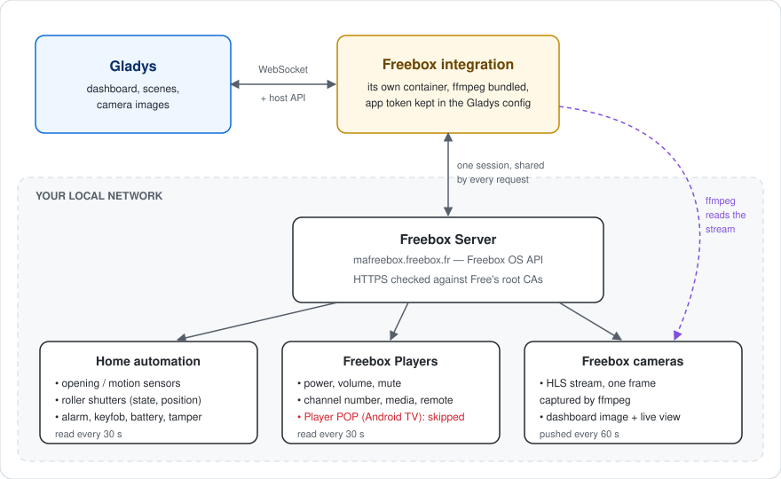
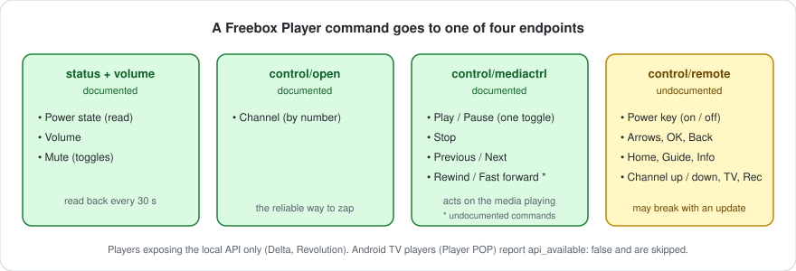

# gladys-freebox


External [Gladys Assistant](https://gladysassistant.com) integration to control your **Freebox** from Gladys: home automation sensors, roller shutters and alarm, Freebox Players (power, volume, channels, media, remote keys) and cameras.

Everything stays **on your local network**: the integration talks to the Freebox OS API on `mafreebox.freebox.fr`, with no Free account and no cloud.

📖 User documentation: [English](docs/en.md) — [Français](docs/fr.md) — [Deutsch](docs/de.md) — [Español](docs/es.md)

## How it works



| Freebox side                                | Gladys support                                                      |
| ------------------------------------------- | ------------------------------------------------------------------- |
| Opening / motion sensors                    | Binary sensors, usable as scene triggers                            |
| Battery, tamper contact                     | Battery level (%), tamper binary sensor                             |
| Roller shutters (`store`, `store_slider`)   | Open / stop / close buttons and position (%)                        |
| Alarm control panel                         | Arm (main / secondary), disarm, skip buttons and textual state      |
| Alarm keyfob                                | Button feature: one click type per physical button                  |
| Players exposing the local API              | Power, volume, mute, channel number, media control, remote keys     |
| Players without it (Player POP, Android TV) | Skipped, with an explicit log line                                  |
| Cameras                                     | Dashboard image every minute, live view on demand (ffmpeg from HLS) |

Every device is read every 30 seconds, except cameras: an ffmpeg capture takes several seconds, longer than the 5-second poll acknowledgement, so camera images are pushed by a loop of their own and captured on demand for the live view.

## Pairing


The Freebox app token is obtained through the **"Pair with the Freebox"** manifest action and persisted through `gladys.setConfig()` under a key that is **not** declared in the `config_schema`, then reloaded on every connection. Three more actions are exposed: **Test the connection**, **Reboot the Freebox** (the API offers no shutdown) and **Unpair**.

The pairing is saved as soon as the box grants it: if listing the devices fails right after (permissions not ticked yet), the action says so instead of reporting a failed pairing.

## Freebox Players



The Freebox Player API is versioned on its own (`/player/{id}/api/v{n}`), and only part of what a remote does is documented. Commands that rely on the virtual remote (`control/remote`) are kept because no documented endpoint reaches the navigation keys, but the user documentation flags them as best-effort.

## Architecture

```
index.js                     SDK wiring: handlers, manifest actions, lifecycle
src/
  devices.js                 discovery / poll / setValue / camera push
  externalId.js              `ext:<selector>:` prefix, added and stripped
  messages.js                user-facing messages, in en / fr / de / es
  freebox/
    FreeboxClient.js         discovery, pairing, shared session, requests
    httpClient.js            native HTTPS client, verified against Free's CAs
    constants.js             app identity, endpoints, Free's root CAs
    convert.js               Freebox -> Gladys device/feature conversion
    deviceMapping.js         function <-> feature mapping + value transforms
    camera.js                ffmpeg snapshot capture
scripts/
  diagnose-realtime.js       standalone probe of the box (websocket, fast poll)
```

## Design notes

**The Freebox certificate is verified.** The box serves a certificate issued by Free's own authorities: the RSA "Freebox Root CA" on older boxes, the "Freebox ECC Root CA" (through an intermediate) on current ones. Both are bundled and the chain is checked; the hostname check also accepts the box's own `*.fbxos.fr` name. A device on the LAN impersonating the Freebox is refused.

**One session for every request.** Gladys polls all devices on the same tick. The login (challenge + HMAC-SHA1) is shared between concurrent callers, and a request that finds its session expired reuses a session another request already reopened.

**External ids are prefixed only at the edge.** The core requires `ext:<selector>:` on every published id. The code keeps the native Freebox scheme (`freebox:{node}:{endpoint}`, `freebox:player:{id}:{type}`) and converts in `externalId.js`.

**Selectors are explicit.** The core builds a feature selector from its name and that column is unique across the whole table: plain names like "Volume" or "Position" would collide with another integration, so selectors are derived from the node and endpoint ids.

**A value the box does not have is not published.** The Freebox answers `null` on endpoints it never refreshed (a battery before its first report): readers return `undefined` and the poll skips them rather than raising a false "empty battery".

## Development

```bash
npm install
GLADYS_HOST_API_URL="http://localhost:1443" \
GLADYS_INTEGRATION_TOKEN="<token>" \
GLADYS_INTEGRATION_SELECTOR="freebox" \
npm start
```

```bash
npm test          # unit tests (node --test)
npm run lint      # eslint
npm run format    # prettier
```

`ffmpeg` must be on the `PATH` to capture camera images; the Docker image installs it.

Releases are cut from GitHub: **Actions → Release → Run workflow**, then pick the bump. The workflow updates the version in `package.json` and the manifest, regenerates `CHANGELOG.md` from the Conventional Commits, pushes the commit and the tag in one atomic push, publishes the GitHub release and builds the multi-arch image (`linux/amd64` + `linux/arm64`).

## License

[Apache-2.0](LICENSE)
