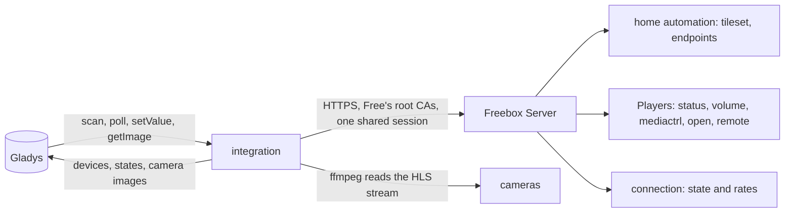
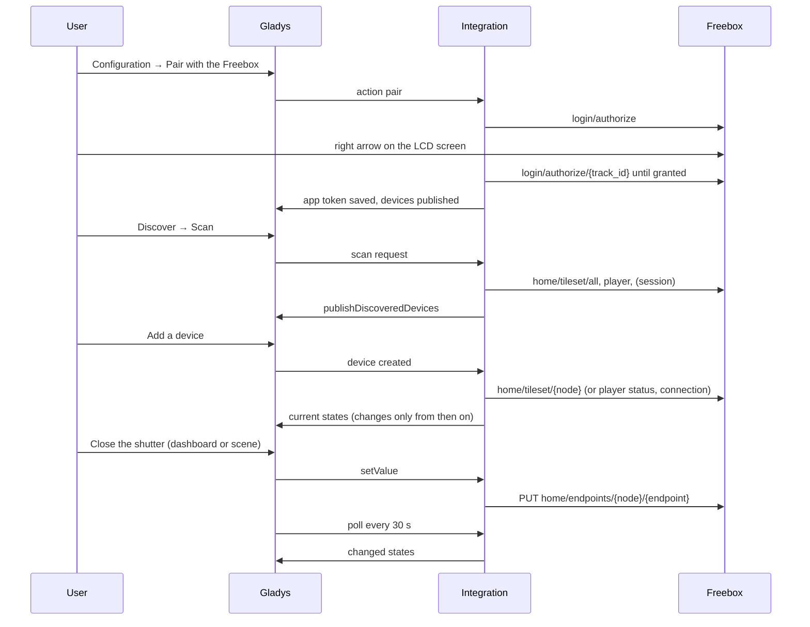
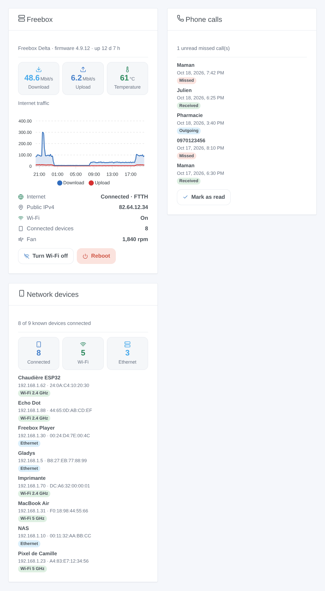
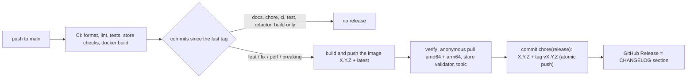

# Gladys Freebox

**English** · [Français](README.fr.md) · [Deutsch](README.de.md) · [Español](README.es.md)

[](LICENSE)
[](https://github.com/William-De71/gladys-freebox/releases)
[](https://github.com/William-De71/gladys-freebox/actions/workflows/release.yml)
[](https://gladysassistant.com)


External [Gladys Assistant](https://gladysassistant.com) integration bringing your **Freebox** into Gladys: home
automation sensors, roller shutters and alarm, Freebox Players (power, volume, channels, media, remote keys), cameras,
the state of the internet connection with its download and upload rates, the Wi-Fi and the temperatures of the box,
three dashboard widgets (the box, the call log, the devices of the network) and scene triggers. Built on
`@gladysassistant/integration-sdk` 0.15.

Everything stays **on your local network**: the integration talks to the Freebox OS API on `mafreebox.freebox.fr`,
with no Free account and no cloud.

User documentation: [English](docs/en.md) · [Français](docs/fr.md) · [Deutsch](docs/de.md) · [Español](docs/es.md).

> Community integration, not affiliated with or endorsed by Free.

## Contents

- [Features](#features)
- [Architecture](#architecture)
- [Devices](#devices)
- [Installation](#installation)
- [Configuration](#configuration)
- [Pairing](#pairing)
- [Freebox Players](#freebox-players)
- [Widgets](#widgets)
- [Scenes](#scenes)
- [Transport](#transport)
- [Development](#development)
- [Release and commit convention](#release-and-commit-convention)
- [Troubleshooting](#troubleshooting)
- [Design notes](#design-notes)
- [Contributing](#contributing)
- [License](#license)

## Features

- **Home automation**: opening and motion sensors, tamper contacts, battery levels, roller shutters (open / stop /
  close and position), alarm control panel (arm, disarm, skip the delay, state) and alarm keyfob.
- **Freebox Players** exposing the local API: power, volume, mute, channel by number, media control and remote keys.
- **Cameras**: dashboard image refreshed every minute, fresh capture for the live view (ffmpeg reads the HLS stream).
- **Internet connection**: a **Freebox Server** device with the state of the connection (`up`, `down`, `going_up`,
  `going_down`) and the download and upload rates in Mbit/s, to watch the line and trigger scenes when it drops.
- **Wi-Fi and temperatures**: the **Freebox Server** device also carries a Wi-Fi switch (`switch` / `binary`, every
  access point of the box) and one `device-temperature-sensor` per sensor the box lists.
- **Dashboard widgets**: **Freebox** (rates, traffic history kept by the box, temperature, internet link, Wi-Fi,
  connected devices, fan, buttons to switch the Wi-Fi and reboot), **Phone calls** (the call log, mark as read) and
  **Network devices** (connected or gone, with IP and MAC addresses).
- **Scenes**: triggers on a **phone call** and on a **device that connects to or leaves** the network, and a
  **Wake-on-LAN** action.
- **Configuration actions**: pair, test the connection, reboot the Freebox, unpair.
- **Four languages** for the configuration screen and the action results: English, French, German, Spanish.

Every state is published **when it changes**, and a device just added in Gladys gets its current values at once. The
LAN hosts and the call log are read every 30 seconds by the integration itself (no device needed): they feed the
widgets and the scene triggers.

## Architecture




From the scan to a command:



## Devices

| Freebox side                                | Gladys feature (category / type)                                                   | Polling    |
| ------------------------------------------- | ---------------------------------------------------------------------------------- | ---------- |
| Opening sensor                              | `opening-sensor` / `binary` (1 = closed)                                           | every 30 s |
| Motion sensor                               | `motion-sensor` / `binary` (1 = motion)                                            | every 30 s |
| Battery, tamper contact                     | `battery` / `integer` (%), `tamper` / `binary`                                     | every 30 s |
| Roller shutters (`store`, `store_slider`)   | `shutter` / `state` (open / stop / close), `shutter` / `position` (%)              | every 30 s |
| Alarm control panel                         | `button` / `push` (arm, secondary arm, disarm, skip), `text` / `text`              | every 30 s |
| Alarm keyfob                                | `button` / `click` (best effort: a press between two polls is missed)              | every 30 s |
| Players exposing the local API              | `television` / power, volume, mute, channel, media and remote keys                 | every 30 s |
| Players without it (Player POP, Android TV) | skipped, with an explicit log line                                                 | —          |
| Cameras                                     | `camera` / `image` (dashboard image every minute, live view on demand)             | own loop   |
| Freebox Server                              | `text` / `text` connection state, `datarate` / `rate` download, upload             | every 30 s |
| Freebox Server (since 1.4.0)                | `switch` / `binary` Wi-Fi, `device-temperature-sensor` / `decimal` (°C) per sensor | every 30 s |

External ids keep the native Freebox scheme (`freebox:{node}:{endpoint}`, `freebox:player:{id}:{type}`,
`freebox:server:{feature}`), prefixed with `ext:<selector>:` as Gladys requires. Selectors are derived from the same
ids, so two homonyms never collide.

## Installation

1. In Gladys (`>= 5.1.0`), open **Integrations**, find **Freebox** in the catalog and install it. Gladys pulls the
   multi-arch image (`linux/amd64`, `linux/arm64`) from `ghcr.io/william-de71/gladys-freebox`.
2. Gladys must run **behind the Freebox** (same local network), so that `mafreebox.freebox.fr` resolves to the box.
3. Pair the integration (see [Pairing](#pairing)), grant the permissions in Freebox OS, then **Discover → Scan** and
   add the devices you want.

## Configuration

| Field / action        | Purpose                                                                               |
| --------------------- | ------------------------------------------------------------------------------------- |
| Pair with the Freebox | asks the box for an app token; confirm on the LCD screen within about 55 seconds      |
| Test the connection   | opens a session and counts the devices the box exposes                                |
| Reboot the Freebox    | reboots the Freebox Server (needs the "Freebox settings modification" permission)     |
| Unpair the Freebox    | forgets the app token; revoke the app in Freebox OS as well to remove it from the box |

Permissions to tick in **Freebox OS → Settings → Access management → Applications → Gladys Assistant**: home
automation and alarm, cameras, Freebox Player control, the settings modification for the reboot and the Wi-Fi switch,
and the call log access for the **Phone calls** widget and trigger. The internet connection, the Wi-Fi state, the
temperatures and the devices of the network need no permission: reading the settings is open to every paired app.

## Pairing


The app token is obtained through the **Pair with the Freebox** action and saved with `gladys.setConfig()` under a
key that is **not** declared in the `config_schema`, then reloaded on every connection. The pairing is saved as soon
as the box grants it: if listing the devices fails right after (permissions not ticked yet), the action says so
instead of reporting a failed pairing.

## Freebox Players


The Freebox Player API is versioned on its own (`/player/{id}/api/v{n}`), and only part of what a remote does is
documented. Commands that rely on the virtual remote (`control/remote`) are kept because no documented endpoint
reaches the navigation keys, but the user documentation flags them as best-effort. "Play" and "Pause" share the
single `play_pause` command, and "Mute" toggles the real state read just before.

## Widgets



| Widget (key)                | Content                                                                                                      | Setting                              | Buttons                                      |
| --------------------------- | ------------------------------------------------------------------------------------------------------------ | ------------------------------------ | -------------------------------------------- |
| Freebox (`box`)             | rates, hottest temperature, RRD traffic chart, internet link, public IPv4, Wi-Fi, connected devices, fan     | `period`: hour, day, week            | Turn Wi-Fi off / on, Reboot (both confirmed) |
| Phone calls (`calls`)       | the last 8 calls, type badge and date; number and duration in the detail panel                               | `show`: all, missed                  | Mark as read (when a call is unread)         |
| Network devices (`network`) | connected count (Wi-Fi, Ethernet), up to 8 devices with IP and MAC address; manufacturer in the detail panel | `show`: connected, disconnected, all | —                                            |

The images are generated from the real widget code (`docs/illustrations/render.sh`), not screenshots. The **Freebox**
card reads the box when it is displayed (30-second cache); the two others read the snapshot of the watch loop, so they
cost no request to the box. The call log needs the **call log access** permission: without it, the card says how to
grant it.

## Scenes

The integration declares two scene triggers and one scene action (category **Integrations** of the scene editor):

| Key                       | Kind                                                | Filters                                              | Variables / outputs                                  |
| ------------------------- | --------------------------------------------------- | ---------------------------------------------------- | ---------------------------------------------------- |
| `phone_call`              | trigger: a call entered the log (once it has ended) | `call_type` (multi-select), `number`                 | `call_type`, `number`, `name`, `duration`            |
| `network_device_presence` | trigger: a device connected or left                 | `event` (`connected`, `disconnected`), `mac`, `name` | `event`, `mac`, `name`, `ip`, `connection`, `vendor` |
| `wake_on_lan`             | action: the box sends a Wake-on-LAN packet          | `mac` (required)                                     | none                                                 |

The first reading after a start is a baseline: no call nor presence change is replayed. Every other value is a device
feature, usable in the scene editor of Gladys like any other.

| When…                             | Trigger in Gladys                                           |
| --------------------------------- | ----------------------------------------------------------- |
| a door opens while nobody is home | Opening sensor → value 0, with a house-empty condition      |
| motion is detected at night       | Motion sensor → value 1, with a time condition              |
| the internet connection drops     | Freebox Server → Internet connection → text equals `down`   |
| the connection is back            | Freebox Server → Internet connection → text equals `up`     |
| the download rate stays high      | Freebox Server → Download rate → above a threshold (Mbit/s) |

Actions work the same way: close the shutters, arm the alarm (`button` / `push`), switch a Player on, tune a channel
by its number. The alarm panel state is the Freebox's own text (`idle` when disarmed): read it on the dashboard to
write a condition on it.

## Transport

`local` only. The integration reaches the Freebox OS API on `mafreebox.freebox.fr` over HTTPS, verified against
Free's root certificates, and reads the camera streams on the local network; it never calls a Free server.

## Development

```bash
npm install
npm test               # unit tests (node --test), no network, no Freebox
npm run lint           # ESLint
npm run format:check   # Prettier, as the CI runs it
npx github:GladysAssistant/integration-store . --skip-image-check   # store checks
docker build -t gladys-freebox:dev .
```

`ffmpeg` must be on the `PATH` to capture camera images; the Docker image installs it. Layout: see
[CLAUDE.md](CLAUDE.md). `scripts/diagnose-realtime.js` probes a real box (websocket, fast polling) and is not part of
the image.

- `test/structure.test.js` compares the devices built from sample nodes (sensors, shutters, alarm, keyfob, camera,
  Player) and the configuration and action keys to `test/fixtures/discovery.baseline.json`, generated from version
  1.2.0: an external id, a selector, a category, a type or a bound never changes — users would have to delete and
  recreate their devices.
- `test/index.test.js` runs `index.js` against the fake Gladys of the SDK (discovery, device creation, polls).
- `test/i18n.test.js` checks the four languages of the manifest, the docs and the READMEs; `test/messages.test.js`
  those of the action results.
- `test/release.test.js` covers the release script (versions, changelog, bump).

Requirements: Gladys `>= 5.1.0` (widgets, scene triggers and actions), Node.js `>= 22.20`.

## Release and commit convention

Releases are automatic. Every push to `main` runs the Release workflow:



- Commits and PR titles follow [Conventional Commits](https://www.conventionalcommits.org/), in English, written
  for the user: they become the changelog lines. `feat` → minor, `fix` / `perf` → patch, `!` or
  `BREAKING CHANGE:` → major.
- `CHANGELOG.md` is generated at the release: never edit it by hand.
- The image is published and checked **before** the manifest on `main` announces the new version.
- Manual run (Actions → Release → Run workflow): `release-as` forces a version, `dry-run` only shows the version
  and the notes.
- A protected `main` would reject the release commit: allow GitHub Actions to bypass the rule, or use a GitHub
  App token.

## Troubleshooting

| Symptom                                        | Likely cause                                                                 |
| ---------------------------------------------- | ---------------------------------------------------------------------------- |
| "Freebox not found on the local network"       | Gladys is not behind the Freebox, or `mafreebox.freebox.fr` does not resolve |
| Pairing "not confirmed on the LCD screen"      | the 55 seconds ran out: stand next to the box, then run the action again     |
| A device is missing from the scan              | its permission is not ticked in Freebox OS: tick it, then scan again         |
| "Freebox session could not be opened"          | the app was revoked in Freebox OS: unpair, then pair again                   |
| A Player is missing                            | Player POP / Android TV: no local API, the integration skips it              |
| A remote key does nothing                      | undocumented `control/remote` key, not honoured by every Player firmware     |
| No camera image                                | check the stream in Freebox OS; the image is refreshed every minute          |
| No "Freebox Server" device on an older install | new device: Discover → Scan, then add it                                     |

Detailed logs: set the environment variable `DEBUG=gladys-integration-sdk` on the container.

## Design notes

**The Freebox certificate is verified.** The box serves a certificate issued by Free's own authorities: the RSA
"Freebox Root CA" on older boxes, the "Freebox ECC Root CA" (through an intermediate) on current ones. Both are
bundled and the chain is checked; the hostname check also accepts the box's own `*.fbxos.fr` name.

**One session for every request.** Gladys polls all devices on the same tick. The login (challenge + HMAC-SHA1) is
shared between concurrent callers, and a request that finds its session expired reuses a session another request
already reopened.

**Changes only.** Every node is read twice a minute, but a value is published only when it changed: Gladys accepts
300 states per minute from an integration, and a home with twenty sensors re-sending everything reached half of it.
When the user adds a device, it is read at once, since Gladys drops the states sent before a device exists.

**A value the box does not have is not published.** The Freebox answers `null` on endpoints it never refreshed (a
battery before its first report): readers return nothing and the poll skips them rather than raising a false "empty
battery".

**Cameras stay out of the poll.** An ffmpeg capture takes several seconds, longer than the 5-second poll
acknowledgement, so camera images are pushed by a loop of their own and captured on demand for the live view.

**The connection state is the Freebox's own word.** `up`, `down`, `going_up` and `going_down` are published as text,
exactly as the API names them, so a scene compares to a value that will not change with the user's language.

## Contributing

Issues and pull requests are welcome: bug reports with the Gladys version, the integration version, the Freebox
model and the logs ([issue templates](.github/ISSUE_TEMPLATE)). Feedback on the
[Gladys forum thread](https://community.gladysassistant.com/t/probleme-installation-integration-freebox/10399) too.
Security problems: see [SECURITY.md](SECURITY.md).

## License

[Apache-2.0](LICENSE) — see [NOTICE](NOTICE). Freebox is a trademark of Free; this project is not affiliated with it.
